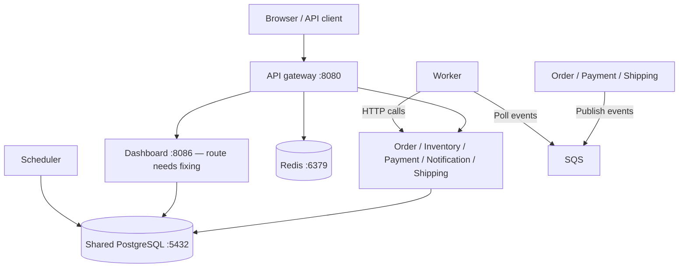

# Application map — DevOps quick guide

This map shows what the application code needs to connect to.

## The big picture

Service calls use HTTP. SQS uses HTTPS on port 443. The worker connects to SQS to collect messages; SQS does not open connections to the worker.

For EKS, put an HTTPS ingress in front of the public entry points. The diagram's browser-to-gateway connection represents API traffic; serving the dashboard UI still needs a routing decision.

## What each part does

| Component | Job | Needs to connect to | Port it listens on |
|---|---|---|---|
| API gateway | Checks login tokens and forwards requests | All five business services, dashboard, optional Redis | 8080 |
| Order service | Creates orders and changes their status | PostgreSQL, SQS | 8081 |
| Inventory service | Tracks stock and reserves items | PostgreSQL | 8082 |
| Payment service | Records charges and refunds | PostgreSQL, SQS | 8083 |
| Notification service | Records simulated notifications | PostgreSQL | 8084 |
| Shipping service | Tracks shipments and accepts shipping updates | PostgreSQL, SQS | 8085 |
| Dashboard API | Serves the UI and reads reporting data | PostgreSQL | 8086 |
| Worker | Reads events and coordinates the order process | SQS, order, inventory, payment, notification, shipping | 8090 — health checks only |
| Scheduler | Runs recurring database jobs | PostgreSQL | 8091 — health checks only |

The gateway and worker have no database connection. The scheduler updates the database directly rather than calling services.

## How an order moves through the system

1. A client sends an order through the gateway to the order service.
2. The order service saves it in PostgreSQL and publishes an event to SQS.
3. The worker reads the event, reserves stock, charges payment, requests a notification and confirms the order.
4. If the order later changes to `processing`, the worker requests a shipment.
5. A delivery update reaches the shipping service through the gateway. Shipping publishes an event, and the worker updates the order to delivered.

These steps happen in the background after order creation. Failed stock reservations or payments trigger cancellation steps. Moving from confirmed to processing requires a separate status change.

## Connections to allow

Use this list when setting up network policies and security groups. Ports below are destination ports.

| From | To | Ports |
|---|---|---|
| Public clients | Planned HTTPS ingress | TCP 443 |
| Ingress | Gateway; dashboard if selected for UI routing | TCP 8080; TCP 8086 |
| Gateway | Order, inventory, payment, notification, shipping, dashboard | TCP 8081–8086 respectively |
| Worker | Order, inventory, payment, notification, shipping | TCP 8081–8085 respectively |
| Seven database clients listed above | PostgreSQL | TCP 5432 |
| Gateway | Redis, if enabled | TCP 6379 in local Compose |
| Order, payment, shipping, worker | SQS | TCP 443 |
| All pods | Cluster DNS | UDP/TCP 53 |
| Kubelet | Each pod's health endpoint | That pod's listener port |

Keep backend services private. Also provide the AWS identity access required by the chosen pod identity setup. Redis production ports/TLS must match your cache configuration.

## Configuration you need to supply

| Setting | Who needs it |
|---|---|
| `DATABASE_URL` | Order, inventory, payment, notification, shipping, dashboard, scheduler |
| `SQS_QUEUE_URL` and AWS region/identity | Order, payment, shipping, worker |
| `JWT_SECRET` | Gateway |
| `REDIS_URL` | Gateway, if rate limiting is enabled |
| `*_SERVICE_URL` | Gateway and worker, if the default service names or ports change |

The default URLs use names such as `http://order-service:8081`. Create matching Kubernetes Services in the same namespace, or override those URLs.

## Things to know before deploying

- **The database is shared.** Dashboard and scheduler use other services' tables. Separate databases would require application changes.
- **Dashboard routing needs fixing.** The gateway removes a path prefix that the dashboard expects. The UI also needs `/dashboard/*`, `/api/*` and `/auth/login` available on the same origin, with authentication decided for dashboard access.
- **The infrastructure is unfinished.** EKS, networking, IAM and ECR Terraform modules are placeholders. The bootstrap file defines the Terraform state bucket; application pods do not use that bucket.
- **SQS still needs provisioning.** Create the queue and a dead-letter queue for failed messages, then grant producers permission to send and the worker permission to receive/delete. Repeated messages can cause duplicate actions in the current code.
- **Local Compose is incomplete.** It points to LocalStack for SQS but does not define LocalStack or create the queue.
- **Health checks have limits.** All services expose `/livez` and `/healthz`, but gateway and worker health checks do not verify their dependencies.

For exact routes, database tables and deeper operational details, see [Service inventory](SERVICE-INVENTORY.md). Known code issues are in [Application fixes](APPLICATION-FIXES.md).
